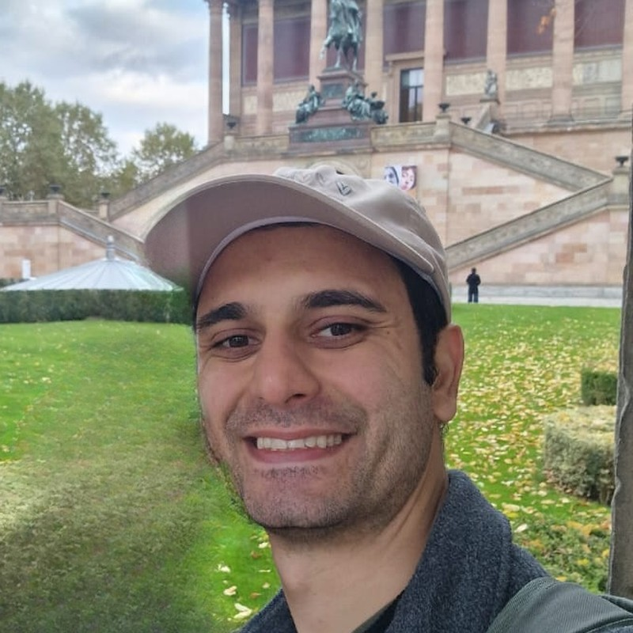

::: {.home-hero}
::: {.home-intro}
# Alan Lahoud

Machine learning & optimization scientist with a PhD in Computer Science. For the past 8 years I have been turning predictive models into business decisions in pricing, forecasting, scheduling and allocation.

I combine machine learning with operations research (MILP, convex optimization, dynamic programming), and I publish on predict-and-optimize methods at venues such as NeurIPS, UAI and CoRL.

[View CV](../cv/){.btn .btn-primary}
[Download PDF](../assets/Alan-Lahoud-CV.pdf){.btn .btn-outline-secondary download="Alan-Lahoud-CV.pdf"}
[LinkedIn](https://www.linkedin.com/in/lahoudalan/){.btn .btn-outline-secondary}
:::

{.avatar fig-alt="Portrait of Alan Lahoud."}
:::

::: {.stat-grid}
::: {.stat}
[+3% RevPAR]{.stat-value}

Revenue lift from a dynamic pricing A/B test at Hyatus Living.
:::

::: {.stat}
[NeurIPS 2025]{.stat-value}

[First-author paper](https://proceedings.neurips.cc/paper_files/paper/2025/hash/b7d9fad0adaa5dbb85178f96d8f6bfeb-Abstract-Conference.html). I have also published at UAI 2024 and CoRL 2025.
:::

::: {.stat}
[5th / 5,558]{.stat-value}

Kaggle M5 Forecasting competition, on hierarchical retail demand.
:::
:::

## What I Work On

::: {.topic-grid}
::: {.topic}
### Pricing

Dynamic pricing and A/B tests that measure real revenue impact, from serviced apartments to retail.
:::

::: {.topic}
### Forecasting

Forecasts of demand, occupancy and revenue that feed planning, plus explainable models whose predictions people can trust.
:::

::: {.topic}
### Optimization

MILP, convex optimization and MPC for scheduling, allocation and routing, often learned end to end with neural networks.
:::
:::

## Currently

I work as an independent ML & optimization consultant. I am lead data scientist for pricing and forecasting at **Hyatus Living** (New York, remote), and I build forecasting models for **Dapper Global** in the public affairs space.

I did my PhD at **Örebro University** (Sweden), within the WASP program, researching predict-and-optimize methods in collaboration with **H&M**.

[lahoudalan93@gmail.com](mailto:lahoudalan93@gmail.com){.btn .btn-primary}
